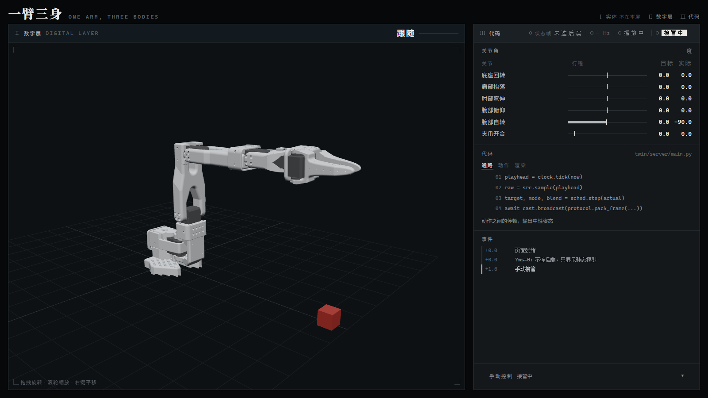

# robot · 实机状态桥

一个进程：独占 follower 串口，50Hz 读六关节角，换算成数字层的度，组 68 字节状态帧，30Hz 推给 WebSocket `:8765`。
默认只读，不调 `send_action`；加 `--teleop` 才写（写的是 leader 的姿态）。twin 后端和浏览器各当一个客户端连它，前端一行不用改。

## 一次完整的起停（插拔线、重启机器都按这个走）

### 起（从插线到出画面）

1. **把两条 USB 线插回原来的口**（口固定 → busid 不漂）
2. **进 wsl**

```powershell
wsl -d Ubuntu --cd ~/lerobot
```

3. **attach** —— 用管理员权限启动 PowerShell，四个设备一次挂上

```powershell
'4-4','4-3','1-1','1-2' | ForEach-Object { usbipd attach --wsl --busid $_ }
```

逐个挂也是这四条：

```powershell
usbipd attach --wsl --busid 4-4     # 依次 4-4 / 4-3 / 1-1 / 1-2
```

busid 以 `usbipd list` 的 `Connected` 段为准（口固定的话每次都是这几个）；插拔后万一变了就改上面那行。

4. **在 WSL 中确认串口编号、进环境**

```bash
ls -l /dev/ttyACM*
conda activate lerobot
```

口固定时就是 `ACM0 = leader`、`ACM1 = follower`；不对就拔 leader 那根线再看一次 `ls`，消失的那个是 leader。

5. **起桥**（WSL 里，见下面「三种起法」）
6. **起后端**（Windows 里，见「后端两种起法」）
7. 浏览器开 `http://127.0.0.1:8000/`（改动过前端代码就 `Ctrl+Shift+R` 硬刷）

### 停（收工 / 拔线前，顺序别反）

1. **WSL 里桥的窗口按 `Ctrl+C`** —— 会 `disconnect()` 释放扭矩，臂会软下来，**手托住它**
2. **Windows 后端窗口按 `Ctrl+C`**；找不到那个窗口就按端口杀：

```bash
netstat -ano | grep -E ":(8000|8001) .*LISTENING"
taskkill //F //PID <PID>
```

3. 确认 `:8765` 也没了（`netstat -ano | grep 8765`），再拔线
4. 可选：`wsl --shutdown` 把 WSL 整个收掉（重开时第 3 步照做）

先停桥再拔线：串口是被正常关闭的，日志干净。反过来先拔线也不会崩（桥冻结在最后一帧、只刷失败），但没必要。

## 三种起法（三选一，都独占 follower 串口）

**① 只读跟随（默认）** —— 桥推状态给 twin，follower **断扭矩**，可以用手掰

```bash
python /mnt/d/CUHKSZ/AIE3001/Project/robot/robot_bridge.py --port /dev/ttyACM1 --id zyf_follower
```

`SO101Follower.connect()` 之后舵机是使能的，臂会硬得像焊住。桥默认 `disable_torque()`，所以手掰得动。
要让它自己撑住当前姿态就加 `--keep-torque`。

**② 遥操 + 屏幕跟随（推荐给演示）** —— 桥自己读 leader、写给 follower

```bash
python /mnt/d/CUHKSZ/AIE3001/Project/robot/robot_bridge.py --port /dev/ttyACM1 --id zyf_follower \
  --teleop --leader-port /dev/ttyACM0 --leader-id zyf_leader
```

**③ 官方 teleoperate / 录数据（要停桥，分时）**

```bash
# 先 Ctrl+C 停桥
lerobot-teleoperate \
  --robot.type=so101_follower --robot.port=/dev/ttyACM1 --robot.id=zyf_follower \
  --teleop.type=so101_leader --teleop.port=/dev/ttyACM0 --teleop.id=zyf_leader
```

## 后端两种起法（Windows）

接实机（数据来自桥，`:8765` 必须已经在跑）：

```bash
D:/conda_envs/so101-twin/Scripts/python.exe twin/server/main.py --source remote --remote-url ws://localhost:8765
```

不接实机（动作库当替身，三个动作循环）：

```bash
D:/conda_envs/so101-twin/Scripts/python.exe twin/server/main.py
```

只开页面、什么数据流都不要（看静态模型 / 零位姿态）：

```bash
D:/conda_envs/so101-twin/Scripts/python.exe twin/tools/serve.py
```

重启前先按端口杀干净，否则 `WinError 10048`：

```bash
netstat -ano | grep -E ":(8000|8001) .*LISTENING"
taskkill //F //PID <PID>
```

## 零位标定（第一次必做，换了校准也要重做）

把 follower 摆成**参考姿态**：其余五个关节归零、**腕部自转摆到与数字层 -90° 一致**（下面那张图；这一档在实机读数上是 0 附近）。然后：



```bash
python /mnt/d/CUHKSZ/AIE3001/Project/robot/robot_bridge.py --capture-zero --port /dev/ttyACM1 --id zyf_follower
```

把打印的 JSON 存成 `robot/offsets.json`（已经有一份 2026-10-24 实测的，重量就覆盖它）。`offset = 参考姿态 − 实机读数`，即 `twin_angle = raw + offset`。
**符号必须这么量出来，不要按公式推** —— 推错了数字层整体偏几十度，动作再顺也是假的。

腕部那一项正常值是 **≈ -87°**，不是 ≈ 0：数字层 -90° 对应实机读数 0，差的那 90° 就该落在这个 offset 里。

参考姿态要换（比如锚到你摆起来更顺手的某个姿态）：

```bash
--ref-pose "0,0,0,0,-60,0"         # 六个数
--ref-pose "wrist_roll=-60"        # 或者只写要改的关节，其余按 0
```

换了参考姿态就必须重量一遍 offsets —— 它锚在哪个姿态，量的时候实机就得摆在哪个姿态。

## 自检（不需要机械臂）

```bash
D:/conda_envs/so101-twin/Scripts/python.exe robot/selftest.py
```

没找到桥就自己用 `--fake` 起一个。判的是换算公式、offset 文件、帧长/帧率/序号、target==actual、断流不补零。
**真机姿态对不对它判不了**，那要靠眼睛看。
